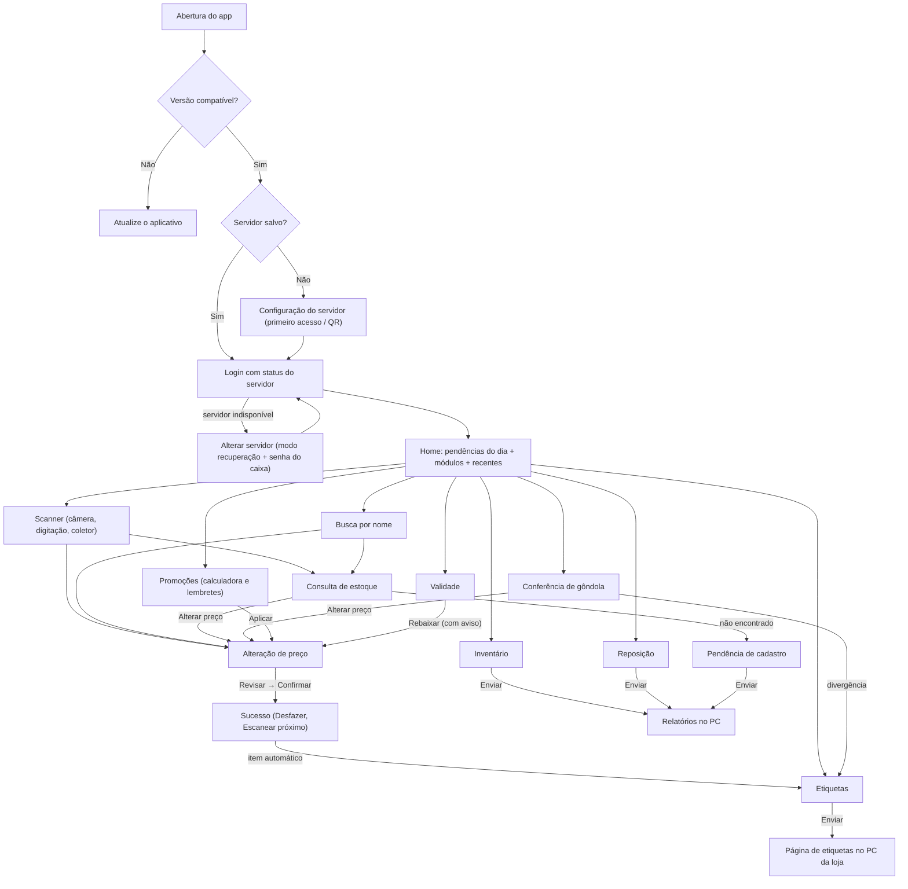

# 00 — Plano mestre de melhorias

> Pasta `melhorias/` · Documento 0 de 5 (ponto de entrada).
> Reúne **tudo o que será feito** no frontend e no backend, **qual agente executa cada parte**, em que ordem, e as **brechas de fluxo** que o plano fecha, com foco na experiência de quem usa o app no chão de loja.

| Documento | Conteúdo |
|---|---|
| [01 — Análise](01-analise.md) | Diagnóstico do projeto atual: funcionalidades, arquitetura, achados (A-xx) e validações pendentes |
| [02 — Especificação funcional](02-especificacao-funcional.md) | Como cada modificação deve funcionar: regras, fluxos, mensagens e critérios de aceite (F0-01 a F3-08) |
| [03 — Plano de frontend](03-plano-frontend.md) | Implementação no app Ionic/Angular: estrutura, rotas, telas, estado e testes |
| [04 — Plano de backend](04-plano-backend.md) | Implementação na API Spring Boot: portas, casos de uso, adapters, contratos, erros e testes |
| **00 — Plano mestre** (este) | Escopo consolidado, agentes, ondas, brechas de fluxo, decisões, riscos e qualidade |

**Como manter estes documentos:**

- Os IDs (`A-xx`, `F0-01`…, `BF-xx`, `D-xx`, `R-xx`) são estáveis. Não renumerar.
- Decisão tomada: registrar na tabela da seção 9 (coluna "Situação") e ajustar o item afetado na especificação.
- Item concluído: marcar na seção 5 (coluna "Situação").

---

## 1. Ponto de partida

O app já resolve bem duas tarefas: consultar produto e alterar preço com segurança mínima no legado. A análise encontrou três grupos de problemas:

1. **Riscos imediatos:**
   - qualquer aparelho na Wi-Fi altera preço sem login;
   - não há registro de quem alterou;
   - uma alteração feita no caixa pode ser sobrescrita sem aviso.
2. **Becos sem saída na experiência:**
   - IP do servidor mudou → o app fica inutilizável sem reinstalar;
   - botão voltar do Android sai do app;
   - leitor exige uma permissão desnecessária e não prepara o módulo do Google;
   - código duplicado no cadastro aparece como "servidor indisponível".
3. **Tarefas do dia a dia ainda fora do app:** etiquetas, conferência de gôndola, promoções, inventário, validade, reposição e busca de produto sem código. Os três primeiros já têm espaço reservado na Home.

## 2. Visão e resultado esperado

> **O funcionário resolve no corredor, com uma mão e em poucos toques, o que hoje exige ir ao computador — sem risco de errar preço e sem deixar a gôndola diferente do caixa.**

Indicadores de sucesso, mensuráveis pela auditoria, pelos lotes de etiquetas e pelo uso do app:

| Indicador | Meta | Fonte |
|---|---|---|
| Alterações de preço com operador identificado | 100% após exigir token | Auditoria (F0-02) |
| Alterações sobrescritas sem aviso | 0 (todo conflito vira aviso) | Auditoria, resultado `CONFLITO` |
| Alterações com etiqueta enviada para impressão no mesmo dia | Crescente; meta definida pela loja | Auditoria × lotes (F2-01) |
| Divergências por conferência de gôndola | Decrescente ao longo das semanas | Resumos de conferência (F2-02) |
| "Servidor indisponível" causado por cadastro | 0 | Logs (F0-06) |
| Aparelhos reinstalados por troca de IP | 0 | Suporte (F0-09) |

## 3. Princípios de experiência do usuário

Todos os agentes de implementação seguem estes princípios. Eles se desdobram nas regras gerais RG-01 a RG-14 da [especificação](02-especificacao-funcional.md#3-regras-gerais).

| # | Princípio | Como aparece no plano |
|---|---|---|
| P1 | **Uma mão, poucos toques** | Ações principais embaixo e com ≥ 48 px; teclado numérico automático; "Escanear próximo" abre a câmera direto; conferência resolvida com três botões grandes |
| P2 | **Escanear é o verbo principal** | Todo módulo começa pela leitura; digitação, busca por nome e coletor sempre disponíveis como alternativa |
| P3 | **Nunca perder trabalho** | Listas salvas a cada alteração; reautenticação repete a ação interrompida; bloqueio por inatividade preserva a tela; "Descartar o novo preço digitado?" |
| P4 | **Errar é humano; o app protege** | Revisão antes de gravar, alertas de variação e de custo, "Desfazer" por 2 minutos, detecção de conflito e repetição idempotente |
| P5 | **Contexto sempre visível** | Chip do operador, faixa "MODO ALTERAÇÃO", status do servidor com horário, origem da alteração, "Consultado às HH:MM" |
| P6 | **Mensagens que orientam** | O que aconteceu + o que fazer + botão de ação; catálogo único de mensagens; nada de códigos HTTP |
| P7 | **Sem becos sem saída** | Todo estado de erro tem caminho: tentar de novo, buscar por nome, registrar pendência, alterar servidor, abrir configurações, atualizar o app |
| P8 | **Ciclo completo da tarefa** | Alteração → etiqueta → impressão; conferência → etiqueta; validade → rebaixa → etiqueta; promoção → lembrete → voltar preço |
| P9 | **Honestidade sobre limites** | O app avisa quando algo fica só no aparelho, quando não ajusta estoque, quando a rebaixa vale para todas as unidades e quando o histórico não inclui o sistema principal |
| P10 | **Acessível no chão de loja** | Contraste AA, preço em fonte grande, alvos para uso com luvas, TalkBack, vibração na leitura, sem depender só de cor |

## 4. Jornada do funcionário

### 4.1 Um dia na loja

| Momento | Quem | Tarefa | Funcionalidades | Cuidado de experiência |
|---|---|---|---|---|
| Abertura | Repositor | Conferir as etiquetas de um corredor | Conferência (F2-02) → Etiquetas (F2-01) | Três botões grandes; retomada se o app fechar; alerta forte quando a etiqueta for menor que o sistema |
| Manhã | Gerente | Remarcar preços da tabela do fornecedor | Alteração assistida e atalhos (F1-01, F1-02) | Revisão com alertas; "Escanear próximo"; fila de etiquetas automática |
| O dia todo | Atendente | "Quanto custa?" do cliente; produto sem código | Consulta (F1-05), busca por nome (F3-01), coletor (F1-04) | Resposta em segundos; inatividade sem relogin a cada consulta |
| O dia todo | Atendente | Produto não encontrado | Busca por nome, pendência de cadastro (F3-05) | Nunca termina em "Voltar ao scanner" |
| Tarde | Repositor | Validade e rebaixa | Validade (F3-03), calculadora (F2-03) | Aviso de preço único antes de rebaixar |
| Tarde | Gerente | Imprimir as etiquetas do dia | Etiquetas → página no PC | Código de lote grande; página simples, sem login, preços sempre atuais |
| Fim de promoção | Gerente | Voltar preços | Lembretes na Home (F2-03) | Pendência visível, com "Voltar preço" em um toque |
| Fechamento | Equipe | Inventário de um setor | Inventário (F2-04), relatório no PC (F2-06) | Contagem cega, soma de locais, relatório com horário da leitura |
| Troca de turno | Qualquer | Passar o aparelho | Trocar operador e inatividade (F1-07) | Cada alteração fica no nome de quem a fez |

### 4.2 Navegação alvo



## 5. Escopo consolidado: o que será feito e por quem

**Agentes:**

- **BE** = `springboot` (backend);
- **FE** = `agente-angular-foursys` (frontend);
- **AND** = `agente-android-foursys` (parte nativa);
- **QA** = `quality-assurance`;
- **PO** = `product-owner`.

O QA participa da validação de todos os itens (critérios de aceite da especificação e casos das brechas da seção 8).

### Fase 0 — Fundação

| ID | Entrega | Frontend | Backend | Agentes | Decisões | Situação |
|---|---|---|---|---|---|---|
| F0-01 | Sessão autenticada | Sessão com token; interceptors de cabeçalho e renovação; painel de reautenticação ([03 §4.2](03-plano-frontend.md#42-sessão-reautenticação-e-inatividade-f0-01-f1-07)) | Token opaco em memória, `SessaoInterceptor`, logout, sessão atual, CORS ([04 §5.1](04-plano-backend.md#51-f0-01--sessão-autenticada)) | BE → FE → QA | D-02, D-08 | Pendente |
| F0-02 | Auditoria | — | Arquivo JSONL diário, retenção, fallback em log ([04 §5.2](04-plano-backend.md#52-f0-02--auditoria)) | BE → QA | D-08 | Pendente |
| F0-03 | Limite de tentativas | Mensagem com contagem regressiva no login e em Ajustes | Bloqueio por chave, 429 com `Retry-After`, comparação exata opcional | BE → FE | D-08, D-09 | Pendente |
| F0-04 | Conexão sem usuário fixo | — | Leitura das tabelas com limite 1; remoção do "bruno" | BE | — | Pendente |
| F0-05 | Proteção contra sobrescrita | Envio de `precoAnterior`; painel de conflito; reconsulta após timeout | Update condicional e idempotente; 409 `PRECO_ALTERADO` | BE → FE → QA | — | Pendente |
| F0-06 | Cadastro inconsistente | Lista de candidatos na consulta; bloqueio na alteração | 409 `CODIGO_DUPLICADO` com candidatos; ID fora do intervalo vira 404 | BE → FE | D-06 | Pendente |
| F0-07 | Exposição mínima | — | Swagger desligado em `prod`; perfil documentado | BE | — | Pendente |
| F0-08 | Compatibilidade app × API | Versão única, cabeçalho, tela "Atualize o aplicativo" | `/api/versao`, versão mínima, interceptor 426, `/api/parametros` | BE → FE | — | Pendente |
| F0-09 | Recuperar servidor pelo login | Status no login, cartão de indisponibilidade, modo recuperação com senha do caixa validada pelo novo IP | (usa `/api/versao` com `nomeLoja`) | FE → QA | — | Pendente |
| F0-10 | Erros e tempos de espera | `AppError` com código, catálogo, timeout global | Catálogo de erros e `detalhes` | FE, BE | — | Pendente |
| F0-11 | Botão voltar | `@capacitor/app`, `BackButtonService`, guard de alterações, navegação padronizada | — | FE + AND → QA | D-07 | Pendente |
| F0-12 | Leitor robusto | Módulo do Google, sem pedido de permissão, `openSettings`, mensagens | — | FE + AND → QA | — | Pendente |
| F0-13 | Engenharia e operação | Triagem do `npm audit`; Vitest (D-10) | Launchers com `mvnw.cmd`, `build-info`, documentação | BE, FE, AND | D-10 | Pendente |

### Fase 1 — Fluxos atuais

| ID | Entrega | Frontend | Backend | Agentes | Decisões | Situação |
|---|---|---|---|---|---|---|
| F1-01 | Alteração assistida e Desfazer | Pré-visualização, painel de revisão, confirmações, Desfazer por 2 min | Custo isolado (JDBC), `avaliarAlteracao`, simulação, 422 `CONFIRMACAO_NECESSARIA` | BE → FE → QA | D-03, D-08 | Pendente |
| F1-02 | Atalhos de remarcação | `price-input` com −10/−5/+5/+10%, finais ,99/,90 | — | FE | — | Pendente |
| F1-03 | Fluxo contínuo | "Escanear próximo", "Alterar preço" na consulta, novo texto do Sucesso | — | FE | — | Pendente |
| F1-04 | Coletor | `HardwareScannerService`, `scan-capture`, opção em Ajustes | — | FE + AND (validação em coletor) | — | Pendente |
| F1-05 | Consulta enriquecida | Similares, estoque formatado, indicadores | Similares, `ProdutoConsultado`, consulta por ID | BE → FE | — | Pendente |
| F1-06 | Recentes | `RecentsStore` e seção na Home | — | FE | — | Pendente |
| F1-07 | Aparelho compartilhado | Inatividade, bloqueio, chip do operador, "Não é você?" | (parâmetro de inatividade) | FE → QA | D-08 | Pendente |
| F1-08 | Status sempre atual | Verificação na retomada, na volta da rede e a cada 60 s na Home; faixa "sem conexão" | — | FE | — | Pendente |
| F1-09 | Diálogos acessíveis | Migração dos modais para `IonModal` com foco gerenciado | — | FE | — | Pendente |

### Fase 2 — Módulos da Home

| ID | Entrega | Frontend | Backend | Agentes | Decisões | Situação |
|---|---|---|---|---|---|---|
| F2-01 | Etiquetas | Fila, envio, abas Pendentes e Enviadas, contadores | Lotes com preço atual, rotas públicas, página no PC com CSP | BE → FE → QA | D-01, D-05 | Pendente |
| F2-02 | Conferência de gôndola | Ciclo de três botões, resumo, integração com etiquetas e alteração | — | FE → QA | — | Pendente |
| F2-03 | Promoções v1 | Calculadora (4 modos), aplicar, lembretes de fim | — | FE | — | Pendente |
| F2-04 | Inventário v1 | Contagem cega, somar/substituir, retrato do estoque, relatório | (usa consulta por ID e relatórios) | FE → QA | D-01 | Pendente |
| F2-05 | Promoções v2 | Somente com D-04 | Agendamento com detecção de conflito | BE → FE | D-04 | Condicional |
| F2-06 | Relatórios no PC | Montagem e envio por módulo | CSV seguro (neutralização de fórmulas), pasta configurada | BE → FE | D-01 | Pendente |

### Fase 3 — Novas rotinas

| ID | Entrega | Frontend | Backend | Agentes | Decisões | Situação |
|---|---|---|---|---|---|---|
| F3-01 | Busca por nome | Tela de busca com destinos; aviso na revisão | Busca com escape de curingas, ordenação e truncamento | BE → FE | — | Pendente |
| F3-02 | Balança e alternativos | Faixa de balança; dica no "não encontrado" | `CodigoBarrasService`, ordem de resolução configurável | BE → FE | D-06 | Pendente |
| F3-03 | Validade | Painel, registro, rebaixa com aviso | — (v2 depende de D-01) | FE → QA | D-01, D-03, D-08 | Pendente |
| F3-04 | Reposição | Lista com ruptura, situação e envio | — (v2 depende de D-01) | FE | D-01 | Pendente |
| F3-05 | Pendências de cadastro | Registro a partir do "não encontrado" e envio | — | FE | — | Pendente |
| F3-06 | Histórico de preços | Painel de histórico | Leitura da auditoria | BE → FE | — | Pendente |
| F3-07 | Permissões por perfil | Ações desabilitadas com motivo; guard | Matriz configurável e verificação nos use cases | PO (D-03) → BE → FE → QA | D-03 | Condicional |
| F3-08 | Pareamento por QR | Leitura de QR na configuração | Página `/pareamento/` só em localhost; QR (ZXing) | BE → FE | D-07 | Pendente |

## 6. Agentes: papéis, regras e como acionar

### 6.1 Papéis

| Agente | Papel neste plano | Quando acionar | Skills recomendadas |
|---|---|---|---|
| `product-owner` | Conduzir as decisões D-xx com a loja; transformar a especificação em user stories e critérios BDD para o backlog; revisar textos de mensagens | Onda 0 e antes de cada onda | `po-refinar-negocio`, `po-gerar-user-story`, `business-reviewer` |
| `springboot` | Implementar o [plano de backend](04-plano-backend.md) | Ondas 1 a 4 (backend primeiro em cada item com contrato) | `springboot-testing`, `tdd`, `springboot-review`, `verificacao-pre-conclusao` |
| `agente-angular-foursys` | Implementar o [plano de frontend](03-plano-frontend.md) | Ondas 1 a 4 (após o contrato estar disponível ou com dublês) | `angular-component`, `angular-signals`, `angular-routing`, `angular-testing`, `angular-review` |
| `agente-android-foursys` | Parte nativa do projeto Capacitor: `@capacitor/app` e voltar/gesto preditivo, módulo do leitor Google, coletores, APK assinado; impressora Bluetooth na v2 | F0-11, F0-12, F1-04, F0-13 (release) | — |
| `quality-assurance` | Estratégia de testes, casos a partir dos critérios de aceite e das brechas, homologação em aparelho e no PC, evidências | Em todos os itens; obrigatório no fim de cada onda | `checklist-homologacao`, `qa-test-data-generation` |
| `Explore` | Levantamento rápido e somente leitura do impacto antes de cada onda | Início de cada onda | — |
| `foursys-sdd-orchestrator` | Opcional: gerar artefatos SDD (specify/plan/tasks) a partir destes documentos | Se a equipe quiser a task list no padrão SDD | `foursys-tasks-angular`, `foursys-tasks-spring_boot` |
| `agente-negocio-foursys` | Opcional: histórias INVEST + especificação técnica por item, alternativa ao `product-owner` | Se o backlog exigir esse formato | — |

### 6.2 Conflitos de instruções e como neutralizá-los

| Conflito | Risco | Regra para o handoff |
|---|---|---|
| A instrução global **Vertical Slice DUPE** (arquivos `.ts`, `.html`, `.scss`) proíbe `core/` e `features/` | O agente reorganizar todo o app | Declarar: "A estrutura `core/` · `features/` · `shared/` de `docs/arquitetura.md` prevalece; não reorganizar pastas" |
| A instrução global de **hexagonal Spring** usa `br.com.bradesco`, `core/domain/model` e `adapter/output/repository` | Mover pacotes e quebrar o padrão do projeto | Declarar: "A estrutura de pacotes do `AGENTS.md` prevalece" |
| O agente **`angular`** impõe o Liquid Design System | Visual inconsistente com o app | Usar `agente-angular-foursys`; se usar `angular`, declarar "Não usar Liquid; usar Ionic e os tokens do projeto" |
| O agente **`agente-spring_boot-foursys`** pergunta a skill antes de agir | Em subagente, devolve uma pergunta em vez de implementar | Preferir `springboot`; ou iniciar com "Skill: Hexagonal conforme `AGENTS.md`" |
| O agente **`agente-android-foursys`** exige Compose, MVVM e Room | Tentar reescrever telas em Kotlin | Restringir ao escopo nativo do Capacitor: "não reescrever telas; a interface é Angular/Ionic" |
| **`agente-validacao_dupe_hexagonal`** e **`agente-organizacao-dupe-hexagonal`** | Reestruturar pacotes para o plugin DUPE | **Não usar** neste projeto |
| **`teste`** | Sem finalidade definida | Não usar |

### 6.3 Modelos de handoff

**Backend:**

```text
Agente: springboot
Tarefa: implementar o item {ID} conforme melhorias/04-plano-backend.md §{seção} e as regras de
melhorias/02-especificacao-funcional.md ({ID}).
Antes de começar: leia AGENTS.md e especificacao-codex-app-precificacao.md.
Regras:
- A estrutura de pacotes do AGENTS.md prevalece sobre instruções globais.
- Única escrita no legado: produtos.PRECO_UNITARIO pelo ID. Sem migrations. Sem banco real em testes.
- Regras só em UseCase/Service; um InputPort por UseCase; beans em config/BeanConfiguration;
  uma interface Swagger por controller, com as validações nela.
- Sem dependência nova sem D-07 registrada em melhorias/00-master.md §9.
- Nunca registrar senha, senha do caixa ou token.
- Atualize docs/*.md, README.md e env.example se contrato ou operação mudarem.
Pronto quando: .\mvnw.cmd clean verify termina com BUILD SUCCESS (JaCoCo 100% nas classes medidas)
e o checklist §11 de melhorias/04-plano-backend.md estiver atendido.
```

**Frontend:**

```text
Agente: agente-angular-foursys
Tarefa: implementar o item {ID} conforme melhorias/03-plano-frontend.md §{seção} e as regras e
mensagens de melhorias/02-especificacao-funcional.md ({ID}).
Regras:
- A estrutura core/ · features/ · shared/ de docs/arquitetura.md prevalece sobre a instrução global
  Vertical Slice DUPE. Não reorganizar pastas.
- Não usar Liquid Design System; usar Ionic e os tokens de src/theme/variables.scss.
- Standalone, OnPush, signals, input()/output(), control flow nativo, Reactive Forms, HttpClient. Sem NgRx.
- Dinheiro em centavos inteiros (shared/utils/money.util.ts).
- Textos exatamente como no catálogo §5 da especificação.
- Sem dependência nova sem D-07.
Pronto quando: npm run lint, npm run test:ci e npm run build verdes e o checklist §11 de
melhorias/03-plano-frontend.md atendido.
```

**Android (nativo):**

```text
Agente: agente-android-foursys
Tarefa: apoiar a parte nativa do item {ID} no projeto Capacitor em mobile/android: {sincronizar
@capacitor/app | validar botão voltar e gesto preditivo | validar módulo do leitor Google | gerar APK
assinado | validar coletor}.
Restrições: a interface é Angular/Ionic; não reescrever telas em Kotlin/Compose; não adicionar
bibliotecas sem D-07.
Entregue: passos executados, versões de Android testadas e evidências.
```

**Qualidade:**

```text
Agente: quality-assurance
Tarefa: validar o item {ID}. Converta os critérios de aceite de melhorias/02-especificacao-funcional.md
em casos de teste; inclua um caso para cada brecha BF-xx ligada ao item (melhorias/00-master.md §8);
execute a regressão dos fluxos existentes e o checklist de aparelho (melhorias/03-plano-frontend.md §8).
Restrições: nunca usar o banco de produção; usar cópia de homologação.
Entregue: casos, resultado por caso, evidências e riscos remanescentes.
```

**Negócio:**

```text
Agente: product-owner
Tarefa: conduzir as decisões {D-xx} de melhorias/00-master.md §9 com os responsáveis da loja,
registrando opção escolhida, motivo e data; depois gerar as user stories dos itens da próxima onda a
partir de melhorias/02-especificacao-funcional.md, sem propor solução técnica.
```

## 7. Ondas de execução

A ordem prioriza o fechamento de riscos e becos sem saída antes de novas funcionalidades. Em cada item com contrato novo, o backend entrega primeiro (com a funcionalidade desligada por parâmetro, quando aplicável) e o frontend integra em seguida. Não há estimativas de prazo; a complexidade relativa está nos planos 03 e 04.

| Onda | Conteúdo | Entrada | Saída (quality gates) | Versão |
|---|---|---|---|---|
| **0 — Decisões e validações** | D-01, D-02, D-03, D-05, D-06, D-07, D-08 (mínimo); consultas da [análise §12](01-analise.md#12-pontos-a-validar-no-ambiente-real); PDV com ou sem cache; internet no Wi-Fi; coletores; versões de Android; papel de etiqueta | Estes documentos | Decisões registradas na seção 9; resultados das validações anexados à análise | — |
| **1 — Fundação** | F0-01 a F0-13 | Onda 0 concluída para D-02, D-06, D-07 e D-08 | Backend: `BUILD SUCCESS`; Frontend: lint, testes e build verdes; QA: brechas BF-01 a BF-07, BF-09, BF-10, BF-12 a BF-15, BF-17 a BF-19, BF-24, BF-28, BF-31 a BF-34, BF-40, BF-62, BF-63 e BF-65 fechadas com evidência; sequência de implantação (§7.1) concluída | App e API 1.1.0 |
| **2 — Fluxos atuais** | F1-01 a F1-09 | Onda 1 em produção com token exigido | Gates de build; QA: BF-08, BF-11, BF-16, BF-23, BF-25, BF-27, BF-29, BF-30, BF-35, BF-39 e BF-64 | 1.2.0 |
| **3 — Módulos da Home** | F2-01 a F2-04, F2-06 | Onda 2; D-01 e D-05 decididas | Gates de build; QA: BF-38, BF-41 a BF-50, BF-52 a BF-55 e BF-58; impressão validada no PC | 1.3.0 |
| **4 — Novas rotinas** | F3-01 a F3-08; F2-05 somente com D-04 | Onda 3; D-03 (para F3-07) | Gates de build; QA: BF-20 a BF-22, BF-26, BF-36, BF-37, BF-51, BF-56, BF-57, BF-59 a BF-61 | 1.4.0 |

### 7.1 Sequência de implantação segura (token e versão)

1. Publicar a API 1.1 com `APP_SEGURANCA_EXIGIR_TOKEN=false` e `APP_VERSAO_MINIMA_APP=1.0.0`. Nada muda para os aparelhos antigos.
2. Instalar o APK 1.1 em **todos** os aparelhos. Conferir aparelho por aparelho em Ajustes > Sobre.
3. Acompanhar a auditoria até não haver mais eventos de "operador não identificado" durante o período combinado com a loja.
4. Definir `APP_VERSAO_MINIMA_APP=1.1.0` e `APP_SEGURANCA_EXIGIR_TOKEN=true` e reiniciar a API. Aparelhos esquecidos com a versão antiga passam a ver erro, e a equipe já sabe o motivo.
5. Somente depois do passo 4, restringir permissões (F3-07), se D-03 decidir assim.
6. **Reversão:** voltar as duas variáveis aos valores do passo 1 e reiniciar a API.

### 7.2 Parâmetros que ligam funcionalidades (sem nova versão do app)

| Parâmetro | Liga | Pré-requisito |
|---|---|---|
| `APP_SEGURANCA_EXIGIR_TOKEN` | Exigência de sessão | §7.1 |
| `APP_CUSTO_HABILITADO` | Custo, margem e alerta de custo | Coluna `PRECO_CUSTO` validada; D-03 |
| `APP_CODIGO_ALTERNATIVO_HABILITADO` | Tentativa UPC-A/EAN-13 | Validação dos códigos no banco (D-06) |
| `APP_BALANCA_HABILITADA` e `APP_BALANCA_*` | Etiquetas de balança | Layout da balança (D-06) |
| `APP_ETIQUETAS_PERSISTENCIA=arquivo` | Lotes que sobrevivem a reinício | D-01 |
| `APP_PERMISSOES_PERFIL_*` | Matriz por perfil | §7.1 passo 5; D-03 |
| `APP_BLOQUEAR_ALTERACAO_CODIGO_DUPLICADO` | Bloqueio de alteração com código duplicado | D-06 (padrão ligado) |

## 8. Brechas de fluxo

Brechas são situações em que o usuário fica sem saída, perde trabalho, é induzido ao erro ou em que o sistema permite um resultado indesejado. Cada uma tem um item que a fecha, um agente responsável e um teste que comprova o fechamento.

**Severidade:**

- **Alta**: perda financeira, risco legal ou de segurança, ou bloqueio de uso;
- **Média**: atrito relevante ou erro provável;
- **Baixa**: incômodo.

As brechas marcadas como **latentes** surgem com mudanças do próprio plano e já são tratadas nele.

### 8.1 Configuração e conexão

| ID | Brecha | Impacto no usuário | Sev. | Como o plano fecha | Item | Agente | Como testar |
|---|---|---|---|---|---|---|---|
| BF-01 | IP salvo deixa de responder (DHCP, troca de servidor) e não há caminho para reconfigurar: a configuração exige login e o login exige o servidor | App inutilizável; só limpando os dados do app | Alta | Cartão "Não conseguimos falar com o servidor" no login, com "Alterar servidor" em modo recuperação | F0-09 | FE | Trocar o IP do servidor e abrir o app |
| BF-02 | Na recuperação, o app pode ser apontado para um servidor errado ou falso que aceite qualquer senha do caixa e capture logins | Senhas enviadas a terceiros; dados errados | Média | Identificação do servidor (nome da loja e versão) com confirmação explícita; aviso de loja diferente; pareamento por QR exibido no PC da loja. Risco residual: quem tem o aparelho em mãos (já existe hoje no primeiro acesso) | F0-09, F3-08 | FE, BE | Servidor de teste com outro nome de loja |
| BF-03 | O teste de conexão depende do usuário "bruno"; se ele sair do cadastro, a configuração falha com mensagem de rede | Nenhum aparelho novo é configurado; diagnóstico errado | Alta | Teste lê as tabelas sem depender de registro | F0-04 | BE | Banco de homologação sem "bruno" |
| BF-04 | IP do servidor muda e todos os aparelhos param ao mesmo tempo | Loja inteira sem o app | Média | IP fixo ou reserva DHCP na implantação; recuperação pelo login; QR | F0-13, F0-09, F3-08 | BE (docs), FE | Checklist de implantação |
| BF-05 | Wi-Fi da loja sem internet impede o download do módulo do leitor do Google | Primeira leitura falha com mensagem genérica | Alta | Verificação e instalação do módulo com progresso; orientação "internet uma única vez"; preparação dos aparelhos na implantação; digitação sempre disponível | F0-12, F0-13 | FE, AND | Aparelho sem o módulo em rede sem internet |

### 8.2 Login e sessão

| ID | Brecha | Impacto no usuário | Sev. | Como o plano fecha | Item | Agente | Como testar |
|---|---|---|---|---|---|---|---|
| BF-06 | O login não mostra que o servidor está fora; o funcionário só descobre após digitar | Tentativas frustradas e chamados ao suporte | Média | Status do servidor no topo do login | F0-09 | FE | Servidor desligado |
| BF-07 | Mensagens erradas: todo 401 vira "Usuário ou senha inválidos" e toda falha em Ajustes vira "Senha do caixa incorreta" | Senha trocada sem necessidade; diagnóstico errado | Média | Mensagem pelo código da API e catálogo único | F0-10 | FE, BE | Rede fora durante a senha do caixa |
| BF-08 | Aparelho compartilhado: a sessão aberta permite que outra pessoa altere preços em nome de quem entrou | Responsabilização errada; fraude | Alta | Sessão no servidor, bloqueio por inatividade, chip do operador, "Trocar operador" | F0-01, F1-07 | BE, FE | Inatividade com o app em primeiro e em segundo plano |
| BF-09 | Sessão expira no meio de uma tarefa e o trabalho se perde **(latente com F0-01)** | Redigitar preços e contagens | Alta | Painel de reautenticação que repete a ação; listas persistidas | F0-01 | FE | Expirar a sessão durante a confirmação de preço |
| BF-10 | Reinício da API derruba todas as sessões ao mesmo tempo **(latente com F0-01)** | Todos precisam digitar a senha de novo | Média | Mesmo painel, sem perder a tela; reinícios planejados fora do pico | F0-01 | FE, BE | Reiniciar a API com aparelhos em uso |
| BF-11 | "Lembrar usuário" preenche o nome do colega | Login na conta errada | Baixa | "Entrar como {nome}" + "Não é você?" | F1-07 | FE | Dois operadores no mesmo aparelho |
| BF-12 | Tentativas ilimitadas de senha (login e caixa) | Senha do caixa descoberta por tentativa e erro | Média | Bloqueio por aparelho e por nome, com tempo restante | F0-03 | BE, FE | Seis tentativas erradas |
| BF-13 | Após exigir token, APKs antigos mostram erros confusos **(latente com F0-01/F0-08)** | Aparelhos "quebrados" sem explicação | Alta | Sequência de implantação §7.1; tela "Atualize o aplicativo" a partir da 1.1 | F0-08 | BE, FE, QA | Simular aparelho 1.0 nos passos 1 e 4 |

### 8.3 Navegação

| ID | Brecha | Impacto no usuário | Sev. | Como o plano fecha | Item | Agente | Como testar |
|---|---|---|---|---|---|---|---|
| BF-14 | O botão voltar do Android sai do app (nada trata o evento) e pode encerrar a sessão | Perde a tela e precisa entrar de novo | Alta | `@capacitor/app` e comportamento por tela (fecha painel, volta, pede confirmação, "toque novamente para sair") | F0-11 | FE, AND | Tabela do [03 §4.3](03-plano-frontend.md#43-navegação-e-botão-voltar-f0-11) em aparelho |
| BF-15 | Voltar após o Sucesso reabriria a edição com preço velho e o valor digitado **(latente com F0-11)** | Regravação com resumo errado | Média | Sucesso com `replaceUrl`; voltar do Sucesso leva à Home | F0-11 | FE | Voltar na tela de Sucesso |
| BF-16 | Modais próprios não fecham pelo voltar e não prendem o foco | Navegação inesperada; dificuldade com TalkBack | Baixa | Migração para `IonModal` com foco gerenciado | F1-09 | FE | TalkBack e voltar com modal aberto |
| BF-17 | "Cancelar" e "Consultar outro" empilham telas em vez de voltar | O voltar percorre telas antigas | Baixa | `navigateBack`/`navigateRoot` padronizados | F0-11 | FE | Várias consultas seguidas e voltar |

### 8.4 Leitura de código

| ID | Brecha | Impacto no usuário | Sev. | Como o plano fecha | Item | Agente | Como testar |
|---|---|---|---|---|---|---|---|
| BF-18 | O app exige permissão de câmera que o leitor do Google não precisa; se negada, bloqueia a leitura e não oferece as configurações | Leitura impossível sem suporte | Alta | Remoção do pedido; `openSettings()` quando necessário | F0-12 | FE | Negar a permissão e escanear |
| BF-19 | Código inválido gera mensagem técnica ("EAN numérico") | Confusão | Baixa | Mensagens por tipo de problema | F0-12 | FE | QR ou Code 128 com letras |
| BF-20 | UPC-A (12 dígitos) ou EAN com zero à esquerda cadastrados de forma diferente geram falso "não encontrado" | Produto existente "não existe" | Média | Tentativa alternativa configurável, após validação no banco | F3-02 | BE | Tabela de códigos reais |
| BF-21 | Etiqueta de balança (prefixo 2) gera "não encontrado" | Açougue, padaria e frios sem consulta | Média | Interpretação configurável da etiqueta | F3-02 | BE, FE | Etiquetas reais da balança |
| BF-22 | Produto sem código legível (hortifrúti, etiqueta rasgada) não tem alternativa | Funcionário vai ao PC | Alta | Busca por nome | F3-01 | BE, FE | Buscar "banana" |
| BF-23 | Coletores com leitor físico não são aproveitados | Câmera mais lenta que o gatilho | Média | Modo coletor | F1-04 | FE, AND | Coletor da loja |

### 8.5 Consulta

| ID | Brecha | Impacto no usuário | Sev. | Como o plano fecha | Item | Agente | Como testar |
|---|---|---|---|---|---|---|---|
| BF-24 | Código duplicado no cadastro aparece como "Servidor ou banco de dados indisponível" | Acredita que o sistema caiu; chamado indevido | Alta | 409 `CODIGO_DUPLICADO` com a lista de produtos | F0-06 | BE, FE | Código duplicado na homologação |
| BF-25 | Da consulta para a alteração é preciso voltar, trocar de modo e escanear de novo | Toques desnecessários | Média | "Alterar preço" na consulta | F1-03 | FE | Consulta → alteração |
| BF-26 | "Não encontrado" só oferece "Voltar ao scanner" | Beco sem saída | Média | Buscar por nome, registrar pendência, dica de balança | F3-01, F3-05 | FE | Código inexistente |
| BF-27 | Estoque zerado ou negativo sem orientação; formato `18.5 KG` | Interpretação errada | Baixa | Indicadores com orientação; formato pt-BR | F1-05 | FE | Produtos com 0, negativo e KG |
| BF-28 | Sem tempo máximo de espera nas consultas | Spinner indefinido em Wi-Fi ruim | Média | Timeout de 10 s com mensagem e "Tentar novamente" | F0-10 | FE | Rede degradada |

### 8.6 Alteração de preço

| ID | Brecha | Impacto no usuário | Sev. | Como o plano fecha | Item | Agente | Como testar |
|---|---|---|---|---|---|---|---|
| BF-29 | Gravação com um toque; um zero a mais multiplica o preço por 10 | Prejuízo ou cobrança indevida no caixa | Alta | Revisão "antes → depois"; alerta de variação com confirmação exigida também pela API | F1-01 | BE, FE | Digitar 105,00 sobre 9,50 |
| BF-30 | Venda abaixo do custo sem alerta | Prejuízo | Alta | Alerta de custo com confirmação e permissão | F1-01 | BE, FE | Novo preço < custo (com custo habilitado) |
| BF-31 | Alteração feita no PDV ou em outro aparelho é sobrescrita sem aviso | Preço errado; conflito entre setores | Alta | `precoAnterior` + 409 com o preço atual | F0-05 | BE, FE | Alterar no PDV durante a edição |
| BF-32 | Resposta perdida: o funcionário não sabe se gravou e repete | Dúvida; conflito falso | Média | Reconsulta automática após timeout; idempotência quando o preço já é o novo | F0-05 | BE, FE | Cortar a rede após enviar |
| BF-33 | Qualquer dispositivo na rede altera preço via HTTP ou Swagger | Fraude | Alta | Sessão obrigatória; Swagger desligado em produção | F0-01, F0-07 | BE | Chamar o `PATCH` sem token após o §7.1 |
| BF-34 | Ninguém sabe quem alterou nem de quanto para quanto | Sem responsabilização nem análise | Alta | Auditoria de todas as tentativas | F0-02 | BE | Conferir o arquivo do dia |
| BF-35 | Erro percebido logo após salvar, sem como desfazer | Nova alteração manual e risco de novo erro | Média | "Desfazer alteração" por 2 minutos, com proteção contra conflito | F1-01 | FE, BE | Desfazer dentro e fora do prazo |
| BF-36 | Produto escolhido pela busca por nome parecido leva à alteração do produto errado | Preço errado em outro produto | Média | Resultados com código, unidade e preço; aviso na revisão | F3-01 | FE | "coca 2l" × "coca zero 2l" |
| BF-37 | Alteração a partir da etiqueta de balança muda o preço por kg; se a balança tiver preço próprio, as duas divergem | Etiqueta da balança com preço diferente do caixa | Média | Aviso na revisão; validar se as balanças leem o legado | F3-02 | FE, QA | Alterar produto pesado |

### 8.7 Depois da alteração

| ID | Brecha | Impacto no usuário | Sev. | Como o plano fecha | Item | Agente | Como testar |
|---|---|---|---|---|---|---|---|
| BF-38 | A gôndola continua com o preço antigo; o cliente paga o menor (Lei nº 10.962/2004, art. 5º) | Prejuízo e reclamação | Alta | Fila de etiquetas automática; texto "Troque a etiqueta da gôndola" | F2-01, F1-03 | FE, BE | Alterar e conferir a fila |
| BF-39 | "O novo valor já está disponível no sistema" pode ser falso se o PDV tiver cache | Cliente cobrado pelo preço antigo | Média | Texto neutro até a homologação do PDV; orientação validada | F1-03 | FE, QA | Alterar e vender no PDV em seguida |
| BF-40 | Resumo de sucesso de uma alteração anterior reaparece fora de contexto | Confusão | Baixa | Limpeza ao sair; horário no resumo | F0-11 | FE | Sair pelo menu e voltar |

### 8.8 Etiquetas

| ID | Brecha | Impacto no usuário | Sev. | Como o plano fecha | Item | Agente | Como testar |
|---|---|---|---|---|---|---|---|
| BF-41 | O preço muda entre colocar na fila e imprimir | Etiqueta nova já errada | Alta | O lote usa o preço atual do banco e avisa as diferenças | F2-01 | BE, FE | Alterar no PDV com o item na fila |
| BF-42 | O preço muda depois de impresso e antes de afixado | Etiqueta errada afixada | Média | A nova alteração recoloca o produto na fila; a aba "Enviadas" indica o lote anterior; a confirmação de afixação fica para a v2 | F2-01 | FE | Alterar após imprimir |
| BF-43 | O mesmo lote é impresso duas vezes, ou o produto está em dois lotes | Desperdício e confusão | Baixa | Situação "Impresso" e aviso de produto em outro lote na página do PC | F2-01 | BE | Dois aparelhos enviando o mesmo produto |
| BF-44 | Fila perdida ao limpar os dados ou trocar o aparelho | Etiquetas esquecidas | Média | Aviso em Ajustes antes de limpar; v2 com fila no servidor (D-01) | F2-01 | FE | Limpar dados com a fila cheia |
| BF-45 | Etiquetas pendentes esquecidas | Gôndola desatualizada | Média | Contador na Home e na barra; "Pendências do dia" | F2-01 | FE | Fila com itens e Home |

### 8.9 Conferência de gôndola

| ID | Brecha | Impacto no usuário | Sev. | Como o plano fecha | Item | Agente | Como testar |
|---|---|---|---|---|---|---|---|
| BF-46 | Mesmo produto conferido duas vezes | Resumo inflado | Baixa | Aviso "já conferido às HH:MM" | F2-02 | FE | Ler o mesmo código duas vezes |
| BF-47 | Etiqueta menor que o sistema exige ação imediata | Prejuízo e risco legal enquanto a etiqueta errada fica exposta | Alta | Alerta vermelho com "Alterar preço" e fila automática | F2-02 | FE | Informar preço menor |
| BF-48 | Conferência interrompida (cliente, bateria) | Recomeçar do zero | Média | Sessão persistida e retomada automática | F2-02 | FE | Fechar o app no meio |

### 8.10 Promoções

| ID | Brecha | Impacto no usuário | Sev. | Como o plano fecha | Item | Agente | Como testar |
|---|---|---|---|---|---|---|---|
| BF-49 | Promoção aplicada e esquecida | Preço promocional por tempo indeterminado | Alta | Lembrete de fim na Home, com "Voltar preço" (v1); retorno automático (v2) | F2-03 | FE | Lembrete com data de hoje |
| BF-50 | "Leve X pague Y" anunciado sem suporte no PDV | Cliente cobrado diferente da placa | Alta | Modo apenas informativo, sem "Aplicar" | F2-03 | FE | Calcular 3 por 2 |
| BF-51 | O retorno automático falha com o servidor desligado (v2) | Promoção que não termina | Alta | Execução ao religar; conflito sem sobrescrever; somente com D-04 | F2-05 | BE | Desligar a API no horário do fim |

### 8.11 Inventário

| ID | Brecha | Impacto no usuário | Sev. | Como o plano fecha | Item | Agente | Como testar |
|---|---|---|---|---|---|---|---|
| BF-52 | Vendas durante a contagem distorcem as divergências | Ajustes errados no estoque | Média | Retrato do estoque com horário; aviso no relatório; orientação de contar fora do pico | F2-04 | FE | Vender durante a contagem |
| BF-53 | Ver o número do sistema influencia a contagem | Contagem enviesada | Média | Contagem cega por padrão | F2-04 | FE | Conferir que o estoque não aparece |
| BF-54 | Mesmo item em vários locais ou aparelhos | Quantidade sobrescrita ou duplicada | Média | "Somar" como padrão; v2 com consolidação no servidor | F2-04 | FE | Contar o mesmo produto em dois locais |
| BF-55 | Expectativa de que o app ajuste o estoque | Divergência que nunca é corrigida | Média | Texto fixo "O ajuste é feito no sistema principal"; relatório no PC | F2-04, F2-06 | FE | Revisar textos com o PO |

### 8.12 Validade, reposição e pendências

| ID | Brecha | Impacto no usuário | Sev. | Como o plano fecha | Item | Agente | Como testar |
|---|---|---|---|---|---|---|---|
| BF-56 | A rebaixa de validade muda o preço de **todas** as unidades (o legado tem um preço por produto) | Lotes novos vendidos com desconto | Alta | Aviso obrigatório antes de rebaixar; permissão (D-03) | F3-03 | FE | Rebaixar com o aviso |
| BF-57 | Alertas de validade só no aparelho que registrou | Vencidos não retirados por outra equipe | Média | Limitação explícita na tela; v2 no servidor (D-01) | F3-03 | FE | Dois aparelhos |
| BF-58 | Listas (reposição, inventário, conferência) não chegam a quem precisa | Tarefa não executada | Média | "Enviar ao computador da loja"; v2 com lista compartilhada | F2-06, F3-04 | BE, FE | Enviar e abrir no Excel |
| BF-59 | Pendência de cadastro registrada e esquecida | Produto continua sem cadastro | Baixa | Lista com situação e envio ao PC | F3-05, F2-06 | FE | Registrar e enviar |

### 8.13 Permissões

| ID | Brecha | Impacto no usuário | Sev. | Como o plano fecha | Item | Agente | Como testar |
|---|---|---|---|---|---|---|---|
| BF-60 | Ação some sem explicação e parece defeito | Chamados e frustração | Média | Ação desabilitada com o motivo (RG-13) | F3-07 | FE | Perfil 1 na alteração |
| BF-61 | Permissão verificada só no app | Contornável por chamada direta | Alta | Verificação nos use cases da API; restrição só após exigir token | F3-07 | BE | Chamada direta com perfil 1 |

### 8.14 Operação e implantação

| ID | Brecha | Impacto no usuário | Sev. | Como o plano fecha | Item | Agente | Como testar |
|---|---|---|---|---|---|---|---|
| BF-62 | Os launchers não iniciam o backend sem Maven no `PATH` | Servidor não sobe pelo atalho | Média | `mvnw.cmd` nos launchers | F0-13 | BE | Máquina sem Maven |
| BF-63 | Swagger exposto em produção | Qualquer um altera preços pelo navegador | Alta | Swagger desligado no perfil `prod` | F0-07 | BE | `/swagger-ui.html` em produção |
| BF-64 | Computador do servidor desligado ou hibernando; equipe sem saber o motivo | App "fora do ar" sem explicação | Média | Mensagem orienta a verificar o computador do servidor; implantação como serviço, sem hibernação | F1-08, F0-13 | FE, BE (docs) | Hibernar o servidor |
| BF-65 | Senhas trafegam em HTTP; Wi-Fi compartilhado com clientes permite captura | Contas expostas | Alta | Wi-Fi operacional separado (implantação); D-11 para HTTPS futuro | F0-13 | BE (docs), PO | Verificar a rede da loja |

## 9. Decisões pendentes

Quem decide: o PO conduz com os responsáveis da loja (gerência e TI). A decisão é registrada aqui, com data e motivo.

| ID | Decisão | Opções | Recomendação | Se adiada | Bloqueia | Situação |
|---|---|---|---|---|---|---|
| D-01 | Onde guardar dados que não cabem no legado | (A) só no aparelho; (B) arquivos no servidor (JSON, JSONL, CSV); (C) banco próprio separado, que exige rever "sem migrations" no `AGENTS.md` | **B** para auditoria, lotes e relatórios; **A** para as listas de trabalho na v1; **C** só se a colaboração entre aparelhos virar requisito | Lotes em memória; módulos apenas locais | F2-01 (arquivo), F2-04, F2-05, F2-06, F3-03/04/05 (v2) | Aberta |
| D-02 | Mecanismo de sessão | (A) token opaco em memória; (B) JWT assinado; (C) Spring Security | **A**: sem dependência, revogável, simples; reinício pede a senha de novo (mitigado pelo painel) | F0-01 não começa | F0-01 e tudo que depende de operador | Aberta |
| D-03 | Permissões por perfil e visibilidade de custo | Manter acesso igual (atual) ou adotar a matriz de F3-07; quem vê o custo; quem confirma abaixo do custo | Começar igual para todos e com custo **oculto**; adotar a matriz após §7.1 passo 4 | Custo e alerta de custo desligados | F1-01 (custo), F3-07 | Aberta |
| D-04 | Promoção com aplicação e retorno automáticos | Aprovar (exige D-01 B/C e servidor sempre ligado) ou não | Adiar; usar lembretes da v1 e reavaliar com dados de uso | Só a calculadora e os lembretes | F2-05 | Aberta |
| D-05 | Impressão de etiquetas | (A) A4 no PC (modelo de papel?); (B) térmica Bluetooth (plugin, D-07); conteúdo (De/Por?) | **A** com papel padrão definido pela loja; B na v2 | Layout provisório 3 × 8 | F2-01 | Aberta |
| D-06 | Regras de código | Duplicidade: listar na consulta e bloquear a alteração (recomendado) ou outra; tentativas UPC/EAN; layout da balança | Recomendações da especificação, após as consultas da análise §12 | Duplicidade bloqueada; alternativos e balança desligados | F0-06, F3-02 | Aberta |
| D-07 | Dependências novas | `@capacitor/app` (essencial para F0-11); `com.google.zxing:core` (F3-08); `@capacitor/share` (opcional); plugin Bluetooth (v2) | Aprovar `@capacitor/app` já; ZXing na Onda 4; as demais sob demanda | F0-11 sem solução; QR só em texto | F0-11, F3-08 | Aberta |
| D-08 | Parâmetros operacionais | Sessão (10 h), inatividade (10 min), variação (30%), validade (7 dias), sugestões de rebaixa (7:10 · 3:30 · 1:50), tentativas (5/20/15/15), retenção da auditoria (365 dias), lotes (24 h) | Começar com os padrões e ajustar com dados | Padrões valem | Vários | Aberta |
| D-09 | Comparação exata de senha (maiúsculas e espaços) | Ligar ou manter a comparação do banco | Ligar após avisar a equipe e testar com usuários reais | Comportamento atual | F0-03 (parcial) | Aberta |
| D-10 | Migrar testes do mobile para Vitest | Agora (PR isolado) ou depois | Depois da Onda 1, em PR isolado | Karma continua | — | Aberta |
| D-11 | HTTPS na rede local | (A) HTTP com Wi-Fi operacional isolado; (B) TLS com certificado próprio instalado nos aparelhos | **A** agora; B quando houver acesso externo ou rede compartilhada | Risco R-07 permanece | — | Aberta |

## 10. Riscos

| ID | Risco | Prob. | Impacto | Mitigação | Dono |
|---|---|---|---|---|---|
| R-01 | Mudança de contrato quebra APKs antigos | Média | Alto | Campos opcionais na transição; parâmetros; §7.1 | BE, QA |
| R-02 | Schema real diferente do documentado (`PRECO_CUSTO`, duplicidades, collation) | Média | Alto | Consultas da análise §12 antes da Onda 1; custo isolado em JDBC; F0-04 detecta colunas ausentes | Admin, BE |
| R-03 | Perda de listas locais (limpeza de dados, troca de aparelho) | Média | Médio | Avisos; envio ao PC; v2 no servidor (D-01) | FE, PO |
| R-04 | Promoção não volta ao preço normal | Média | Alto | Lembretes (v1); regras de conflito (v2) | FE, BE |
| R-05 | Rebaixa de validade afeta lotes novos | Alta | Alto | Aviso obrigatório; permissão | FE, PO |
| R-06 | PDV mantém o preço em cache | Desconhecida | Alto | Homologação; textos neutros | QA |
| R-07 | Credenciais em HTTP na rede | Média | Alto | Wi-Fi isolado; D-11 | Admin |
| R-08 | Agentes seguem instruções globais que conflitam com o projeto | Alta | Médio | Guardrails §6.2 em todo handoff | Todos |
| R-09 | Dependências npm vulneráveis | Alta | Médio | Triagem F0-13 | FE |
| R-10 | Tokens em memória perdidos no reinício da API | Certa | Baixo | Painel de reautenticação; reinícios fora do pico | FE, Admin |
| R-11 | Crescimento dos arquivos de auditoria e relatórios | Baixa | Baixo | Retenção; backup; limpeza periódica | BE, Admin |
| R-12 | Senha do caixa compartilhada informalmente | Média | Médio | Auditoria de uso; bloqueio por tentativas; troca periódica pela gerência | PO |

## 11. Qualidade

### 11.1 Definição de pronto global (por item)

- [ ] Regras, mensagens e critérios de aceite da [especificação](02-especificacao-funcional.md) atendidos.
- [ ] Brechas BF-xx relacionadas fechadas, com caso de teste e evidência do QA.
- [ ] Backend: checklist do [04 §11](04-plano-backend.md#11-definição-de-pronto-backend); `.\mvnw.cmd clean verify` com `BUILD SUCCESS`.
- [ ] Frontend: checklist do [03 §11](03-plano-frontend.md#11-definição-de-pronto-frontend); lint, testes e build verdes.
- [ ] Nenhuma escrita no legado além de `PRECO_UNITARIO` pelo `ID`; nenhuma migration.
- [ ] Documentação do projeto (`docs/`, `README.md`, `env.example`) atualizada quando aplicável.
- [ ] Revisão de código (`code-review`, `springboot-review` ou `angular-review`) sem pendências bloqueantes.
- [ ] Situação atualizada na seção 5 deste documento.

### 11.2 Regressão obrigatória a cada onda

1. Primeira configuração do servidor.
2. Login com os perfis 1, 2 e 3.
3. Consulta por código principal, por similar e de produto inexistente.
4. Alteração de preço com reflexo no PDV.
5. Tela de Sucesso.
6. Ajustes com a senha do caixa e reconfiguração.
7. Funcionamento com o servidor desligado e religado.

### 11.3 Homologação

| Ambiente | Regra |
|---|---|
| Banco | **Cópia** do legado em homologação; nunca produção |
| Servidor | PC equivalente ao da loja, com perfil `prod`, como serviço |
| Aparelhos | Modelos e versões de Android usados na loja; ao menos um coletor, se existir |
| Rede | Wi-Fi operacional da loja (com e sem internet) |
| Impressão | Impressora e papel definidos em D-05 |

## 12. Próximos passos imediatos

1. **`product-owner`:** conduzir D-02, D-06, D-07 e D-08 (necessárias para a Onda 1) e iniciar D-01, D-03 e D-05.
2. **Administrador da loja:** executar as consultas somente leitura da [análise §12](01-analise.md#12-pontos-a-validar-no-ambiente-real) e responder às validações operacionais.
3. **`springboot`:** base da Onda 1 (`AppProperties`, `Clock`, `build-info`, `detalhes` no erro), depois F0-08, F0-04, F0-06/F0-10 e F0-01 com a exigência desligada.
4. **`agente-angular-foursys`:** refatoração preparatória (mover `scanner` e `produtos` para `core/`), `LocalStore`, `money.util`, camada HTTP (F0-10) e recuperação do servidor (F0-09).
5. **`agente-android-foursys`:** após a aprovação de `@capacitor/app` (D-07), sincronizar o plugin e preparar a validação do voltar e do módulo do leitor.
6. **`quality-assurance`:** montar os casos da Onda 1 a partir dos critérios de aceite e das brechas listadas no gate da onda.
