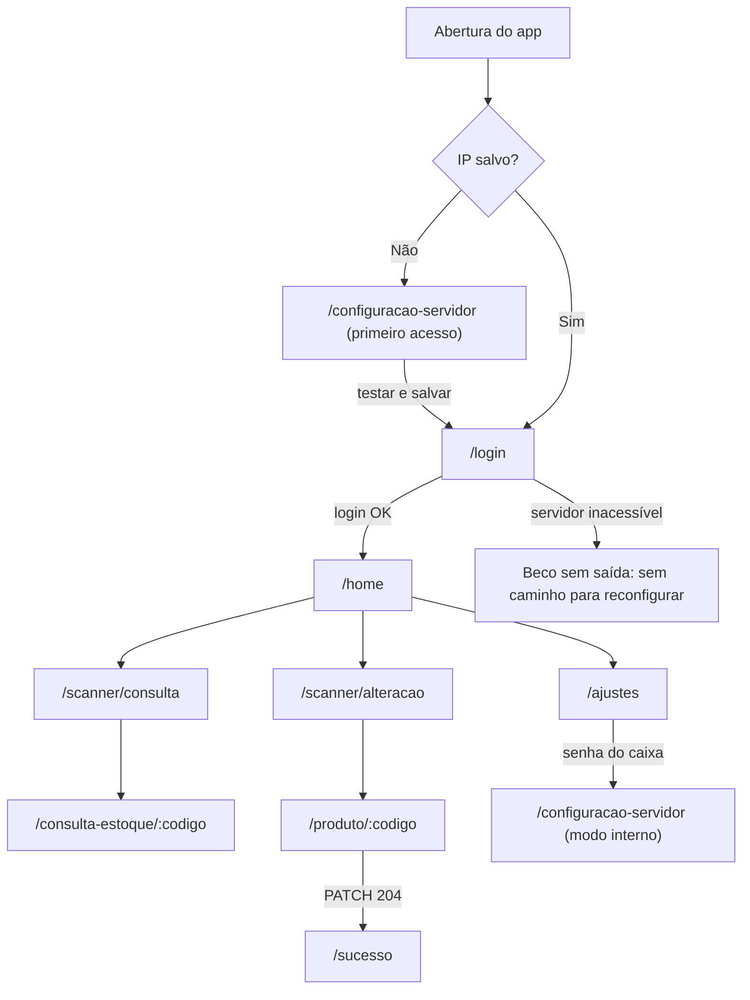

# 01 — Análise do projeto

> Pasta `melhorias/` · Documento 1 de 5. O índice geral, a divisão por agente e a ordem de execução estão no [plano mestre](00-master.md).

## 1. Objetivo

Registrar o diagnóstico completo do App Satélite de Precificação — o que existe, como funciona, o que está sólido, o que precisa de correção e onde estão as oportunidades — e servir de base para:

- [02 — Especificação funcional](02-especificacao-funcional.md): como as novas modificações devem funcionar;
- [03 — Plano de frontend](03-plano-frontend.md) e [04 — Plano de backend](04-plano-backend.md): como implementá-las;
- [00 — Plano mestre](00-master.md): o que será feito, por qual agente, com foco em experiência do usuário e brechas de fluxo.

## 2. Escopo e método

| Item | Detalhe |
|---|---|
| Base analisada | `backend/`, `mobile/` (inclusive `mobile/android/`), `docs/`, `setup/`, `AGENTS.md`, `especificacao-codex-app-precificacao.md`, `README.md`, `env.example` |
| Execuções realizadas | `.\mvnw.cmd clean verify` (backend); `npm install`, `npm run lint` e `npm run build` (mobile); subida da API sem credenciais do banco |
| Inspeções adicionais | Documentação do plugin `@capacitor-mlkit/barcode-scanning` instalado em `node_modules`; código Android gerado pelo Capacitor (`MainActivity`, `AndroidManifest.xml`) |
| Fora do alcance | Banco legado real, PDV VB.NET e aparelhos físicos. Tudo o que depende deles está marcado como **a validar** |

## 3. Contexto do produto

- O mercado opera um sistema legado em VB.NET (PDV e retaguarda) sobre MySQL 5.5 instalado na loja.
- O aplicativo é uma **extensão móvel** desse sistema para o funcionário no salão de vendas: consultar produto e estoque e alterar o preço de venda sem ir até o computador.
- Comunicação: celular → Wi-Fi da loja → API Spring Boot (porta 8080) → MySQL. O celular nunca acessa o banco.
- Usuários: funcionários cadastrados na tabela legada `usuarios`, com perfis 1 (usuário), 2 (gerencial) e 3 (administrador). Pelo requisito atual, os três perfis têm o mesmo acesso.
- Objetivo declarado para a evolução: **facilitar o dia a dia do funcionário de mercado**.

## 4. Funcionalidades existentes

| # | Funcionalidade | Rota no app | Endpoint | Comportamento atual |
|---|---|---|---|---|
| 1 | Primeira configuração do servidor | `/configuracao-servidor` | `GET /api/configuracoes/conexao` | Exige IPv4 válido, testa por até 7 s e salva `http://IP:8080` no `localStorage` do aparelho |
| 2 | Login | `/login` | `POST /api/auth/login` | Nome e senha em texto puro contra `usuarios`; guarda código, nome e perfil no `sessionStorage`; "Lembrar usuário" grava o nome no `localStorage` |
| 3 | Home | `/home` | `GET /actuator/health` (4 s) | Saudação, status do servidor e atalhos. "Promoções" mostra um aviso de "próxima versão"; "Etiquetas" e "Inventário" aparecem desabilitados |
| 4 | Scanner | `/scanner/:modo` (`consulta` ou `alteracao`) | — | Leitura pela câmera com `scan()` do ML Kit (EAN-8, EAN-13, UPC-A, UPC-E, Code 128) ou digitação de até 13 dígitos |
| 5 | Consulta de estoque | `/consulta-estoque/:codigo` | `GET /api/produtos/{ean}` | Código, descrição, NCM, estoque e preço, somente leitura |
| 6 | Alteração de preço | `/produto/:codigo` | `GET /api/produtos/{ean}` e `PATCH /api/produtos/{id}` | Campo com máscara de centavos; grava ao tocar em "Salvar novo preço" |
| 7 | Sucesso | `/sucesso` | — | Resumo (produto, código, preço anterior e novo) guardado no `sessionStorage` |
| 8 | Ajustes | `/ajustes` → `/configuracao-servidor` | `POST /api/configuracoes/validar-senha-caixa` | A senha do caixa libera uma única abertura da configuração em modo interno |

Regra de busca de produto: código principal (`produtos.CODIGO_PRODUTO`) → código similar (`produtos_similares.CODIGO_SIMILAR` → `CODIGO_PRODUTO`) → 404.

### 4.1 Navegação atual



## 5. Arquitetura

### 5.1 Backend

- Spring Boot 3.5.4, alvo Java 17, Maven Wrapper (Maven 3.9.5), Connector/J 5.1.49 e `MySQLLegacyDialect` para compatibilidade com MySQL 5.5; `ddl-auto: none`.
- Arquitetura hexagonal moderada: `core` e `port` em Java puro; casos de uso montados em `config/BeanConfiguration`; JPA e transações em `adapter/output`; controllers, DTOs e validação HTTP em `adapter/input`.
- Cada controller implementa uma interface Swagger própria em `adapter/input/swagger`, onde também ficam as restrições de validação dos parâmetros (`@Positive`, `@Valid`).
- Erros padronizados por `GlobalExceptionHandler` no formato `timestamp`, `status`, `error`, `code`, `message` e `path`, sem stack trace e sem SQL.
- `DatabaseHealthIndicator` (`SELECT 1`) alimenta `/actuator/health`.
- Configuração por `.env` (importado via `spring.config.import`), CORS configurável e log em arquivo (`LOG_FILE`).

### 5.2 Aplicativo móvel

- Angular 21 com componentes standalone, `OnPush`, signals e Reactive Forms; Ionic 8 (modo `md`); Capacitor 8 para Android.
- Organização `core/` (auth, config, connectivity, feedback, http), `features/` (auth, home, product-pricing, scanner, settings) e `shared/` (ui, pipes, utils, validators), conforme [docs/arquitetura.md](../docs/arquitetura.md).
- Leitor de código encapsulado por uma porta (`BARCODE_SCANNER`) e um serviço, o que facilita testes e substituição.
- Guards: `configurationGuard` (exige IP salvo), `authGuard` (exige sessão), `serverConfigurationGuard` (exige sessão e senha do caixa quando já existe configuração).
- Interceptor único (`appErrorInterceptor`) que converte qualquer erro HTTP em `AppError` com mensagem fixa por status.
- Armazenamento: `localStorage` (URL da API, nome lembrado) e `sessionStorage` (usuário da sessão e resumo de sucesso).

### 5.3 Integração com o legado

| Tabela | Colunas usadas | Acesso |
|---|---|---|
| `produtos` | `ID`, `CODIGO_PRODUTO`, `DESCRICAO`, `UN`, `PRECO_UNITARIO`, `CODIGO_NCM`, `ESTOQUE_ATUAL` | Leitura; escrita somente em `PRECO_UNITARIO`, pelo `ID` |
| `produtos_similares` | `CODIGO_SIMILAR`, `CODIGO_PRODUTO` | Leitura |
| `usuarios` | `codigo`, `nome`, `senha`, `perfil` | Leitura |
| `senha` | `ID`, `SENHA_CAIXA` | Leitura |

`PRECO_CUSTO` consta do mapeamento da especificação (seção 14.1), mas **não é mapeado nem exposto**. O teste `ProdutoControllerTest.getDeveRetornarProduto` garante que a resposta não contém `precoCusto`. Isso é uma decisão vigente, e não uma lacuna: mostrar o custo no app exige decisão de negócio (ver D-03).

### 5.4 Ferramentas de apoio

A pasta `setup/` contém launchers Windows compilados a partir de [SetupLauncher.cs](../setup/src/SetupLauncher.cs) para iniciar backend e frontend, gerar o APK e executar os testes.

## 6. Qualidade e testes

| Verificação | Resultado |
|---|---|
| `.\mvnw.cmd clean verify` | BUILD SUCCESS: 48 testes, sem falhas; regra JaCoCo de 100% de linhas atendida nas classes medidas |
| `npm run lint` | Sem apontamentos |
| `npm run build` | Concluído (bundle inicial de aproximadamente 726 kB, 179 kB transferidos) |
| `npm run test:ci` | Não executado nesta análise (requer Chrome headless) |
| `npm audit` | 41 vulnerabilidades reportadas na instalação (1 baixa, 15 moderadas, 19 altas, 6 críticas), triagem pendente |
| Testes do mobile | 24 arquivos `.spec.ts`, ao lado dos arquivos testados |
| Subida da API sem `.env` | Sobe na porta 8080; Swagger responde 200; `/actuator/health` responde 503 por falta de credenciais |

Padrões de teste do backend: AAA, Mockito, MockMvc em modo `standaloneSetup` com o `GlobalExceptionHandler`, sem banco real.

## 7. Ambiente observado na máquina de desenvolvimento

| Item | Situação | Consequência |
|---|---|---|
| Java | OpenJDK 25 (Microsoft) | Compila com alvo 17 sem problemas |
| Maven | Fora do `PATH` | Usar `.\mvnw.cmd`; os launchers do `setup` falham (usam `mvn.cmd`) |
| Node.js / npm | 22.14 / 11.18 | Compatível com o projeto |
| Git | Fora do `PATH` | Sem histórico consultável por linha de comando |
| MySQL local | Serviço `MySQL84` em execução | O Connector/J 5.1 provavelmente não autentica no MySQL 8.4 com o plugin padrão; para testes manuais locais, usar um MySQL compatível com o legado. **A validar** |
| PowerShell 5.1 | Avisos do Maven no stderr geram exit code 1 | Confirmar sucesso pela linha `BUILD SUCCESS`, não pelo exit code |

## 8. Restrições vigentes

De `AGENTS.md` e da especificação:

1. Não alterar o schema legado e não criar migrations.
2. Única escrita permitida: `produtos.PRECO_UNITARIO`, sempre pelo `ID`.
3. Não usar o banco real em testes.
4. Manter a arquitetura hexagonal moderada, com domínio e aplicação sem Spring/JPA.
5. Uma interface Swagger por controller.
6. Regras de negócio somente em UseCases e Services.
7. Testes para toda mudança de comportamento; documentação atualizada quando contratos ou operação mudarem.
8. Nenhuma dependência nova sem necessidade e justificativa.
9. Credenciais apenas nas variáveis descritas em `env.example`.
10. Não implementar cache offline (especificação, seção 35).
11. Não cadastrar ou excluir produtos, não alterar o preço de custo, não inventar colunas, não presumir unicidade sem validar, não usar `double` para preço e não adicionar NgRx (especificação, seção 50).

## 9. Pontos fortes

- Fronteira de escrita no legado mínima e explícita (query JPQL dedicada que altera só `PRECO_UNITARIO`).
- Domínio limpo e testado: casos de uso pequenos, portas por operação e cobertura total das classes medidas.
- Erros padronizados e sem vazamento de detalhes internos.
- App moderno e consistente: signals, `OnPush`, control flow nativo, componentes de UI reutilizáveis (`page-state`, `connection-status`, `home-action-card`, `product-card`, `price-change-summary`).
- Configuração do servidor feita pelo próprio operador, sem build por loja.
- Interface preparada para crescer: cards "Promoções", "Etiquetas" e "Inventário" já existem na Home e a aba "Etiquetas" já existe na barra inferior.

## 10. Achados

Severidade: **Alta** (risco de perda financeira, segurança ou bloqueio de uso), **Média** (atrito relevante ou risco moderado), **Baixa** (refinamento).

### 10.1 Segurança e acesso

| ID | Achado | Evidência | Severidade | Tratamento |
|---|---|---|---|---|
| A-01 | O `PATCH` de preço não exige autenticação e o Swagger UI fica ativo em qualquer perfil: qualquer dispositivo na Wi-Fi pode alterar preços, até pelo navegador. O CORS não protege contra clientes fora do navegador | [ProdutoController.java](../backend/src/main/java/br/com/mercado/precificacao/adapter/input/controller/ProdutoController.java#L41-L47), [application-prod.yml](../backend/src/main/resources/application-prod.yml) | Alta | F0-01, F0-07 |
| A-02 | Alterações sem trilha de auditoria: o log registra apenas o `id` do produto, sem usuário, preço anterior ou novo | [ProdutoPersistenceAdapter.java](../backend/src/main/java/br/com/mercado/precificacao/adapter/output/persistence/ProdutoPersistenceAdapter.java#L56-L59) | Alta | F0-02 |
| A-03 | Sem limite de tentativas no login e na senha do caixa (até 10 caracteres, normalmente um PIN) | [AuthController.java](../backend/src/main/java/br/com/mercado/precificacao/adapter/input/controller/AuthController.java), [ValidarSenhaCaixaUseCase.java](../backend/src/main/java/br/com/mercado/precificacao/core/usecase/ValidarSenhaCaixaUseCase.java) | Média | F0-03 |
| A-04 | A comparação de senha é feita no SQL (`findFirstByNomeAndSenha`, `existsBySenhaCaixa`); dependendo da collation, maiúsculas e minúsculas e espaços finais podem ser ignorados. **A validar** | [UsuarioJpaRepository.java](../backend/src/main/java/br/com/mercado/precificacao/adapter/output/persistence/repository/UsuarioJpaRepository.java) | Média | F0-03, D-09 |
| A-05 | Credenciais trafegam em HTTP na Wi-Fi. É requisito atual e está documentado no README | [README.md](../README.md) | Média | Risco R-07, D-11 |

### 10.2 Robustez da API

| ID | Achado | Evidência | Severidade | Tratamento |
|---|---|---|---|---|
| A-06 | O teste de conexão depende do usuário fixo `bruno`. Se ele for renomeado ou excluído, nenhum aparelho consegue ser configurado, e a mensagem sugere problema de rede | [TestarConexaoServidorUseCase.java](../backend/src/main/java/br/com/mercado/precificacao/core/usecase/TestarConexaoServidorUseCase.java#L8) | Alta | F0-04 |
| A-07 | Código duplicado em `produtos` ou um similar que aponta para mais de um principal: as consultas retornam `Optional`, o Spring Data lança `IncorrectResultSizeDataAccessException` (uma `DataAccessException`) e a API responde **503 "Servidor ou banco de dados indisponível"**. O usuário acredita que o sistema caiu. A especificação não garante unicidade ("unique ou index") | [ProdutoJpaRepository.java](../backend/src/main/java/br/com/mercado/precificacao/adapter/output/persistence/repository/ProdutoJpaRepository.java), [ProdutoSimilarJpaRepository.java](../backend/src/main/java/br/com/mercado/precificacao/adapter/output/persistence/repository/ProdutoSimilarJpaRepository.java), [GlobalExceptionHandler.java](../backend/src/main/java/br/com/mercado/precificacao/adapter/exception/GlobalExceptionHandler.java) | Alta | F0-06 |
| A-08 | Sobrescrita silenciosa: o `PATCH` não verifica se o preço mudou desde a consulta (no PDV ou em outro aparelho) | [AtualizarPrecoProdutoUseCase.java](../backend/src/main/java/br/com/mercado/precificacao/core/usecase/AtualizarPrecoProdutoUseCase.java) | Alta | F0-05 |
| A-09 | IDs acima do limite de `int` geram `ArithmeticException` (`Math.toIntExact`), que vira 500 | [ProdutoPersistenceAdapter.java](../backend/src/main/java/br/com/mercado/precificacao/adapter/output/persistence/ProdutoPersistenceAdapter.java#L44) | Baixa | F0-06 |

### 10.3 Aplicativo: fluxo e experiência

| ID | Achado | Evidência | Severidade | Tratamento |
|---|---|---|---|---|
| A-10 | **Beco sem saída**: com o IP salvo inacessível (troca de IP por DHCP, troca do servidor), o login falha e não há caminho para reconfigurar. A configuração exige sessão e senha do caixa quando já existe IP salvo, e Ajustes exige login. A única saída é limpar os dados do app no Android | [server-configuration.guard.ts](../mobile/src/app/core/config/server-configuration.guard.ts), [login.page.html](../mobile/src/app/features/auth/pages/login/login.page.html), [auth.guard.ts](../mobile/src/app/core/auth/auth.guard.ts) | Alta | F0-09 |
| A-11 | Botão voltar do Android sem tratamento: `@capacitor/app` não está instalado e nem a [MainActivity.java](../mobile/android/app/src/main/java/br/com/mercado/precificacao/MainActivity.java) nem a `BridgeActivity` tratam o voltar. O comportamento padrão da Activity é sair do app, o que pode descartar a sessão (`sessionStorage`). **A validar em aparelho** | `mobile/package.json` (sem `@capacitor/app`) | Alta | F0-11 |
| A-12 | Leitor: pela documentação do plugin, `scan()` (leitor do Google) **não exige permissão de câmera** e deve ser precedido de `isGoogleBarcodeScannerModuleAvailable()`. O app pede a permissão e bloqueia a leitura se ela for negada, não verifica nem instala o módulo e não oferece atalho para as configurações (`openSettings()`). Com APK instalado fora da Play Store e Wi-Fi sem internet, a primeira leitura pode falhar com mensagem genérica. **A validar em aparelho** | [barcode-scanner.service.ts](../mobile/src/app/features/scanner/data-access/barcode-scanner.service.ts) | Alta | F0-12 |
| A-13 | Mensagens fixas por status: todo 401 vira "Usuário ou senha inválidos." e todo 404 vira "Produto não encontrado.". Em Ajustes, qualquer falha (até sem rede) mostra "Senha do caixa incorreta." | [app-error.interceptor.ts](../mobile/src/app/core/http/app-error.interceptor.ts), [settings.page.ts](../mobile/src/app/features/settings/pages/settings/settings.page.ts) | Média | F0-10 |
| A-14 | Sem timeout nas chamadas de produto, login e senha do caixa (só o health, 4 s, e o teste de conexão, 7 s, têm) | [produto-api.service.ts](../mobile/src/app/features/product-pricing/data-access/produto-api.service.ts), [auth-api.service.ts](../mobile/src/app/features/auth/data-access/auth-api.service.ts) | Média | F0-10 |
| A-15 | Gravação com um toque, sem revisão "antes → depois" nem alerta para valores atípicos: um zero a mais multiplica o preço por 10 | [product-price.page.ts](../mobile/src/app/features/product-pricing/pages/product-price/product-price.page.ts#L81) | Alta | F1-01 |
| A-16 | Depois de alterar o preço, nada orienta a troca da etiqueta da gôndola. Havendo divergência, o consumidor paga o menor preço (Lei nº 10.962/2004, art. 5º) | [pricing-success.page.html](../mobile/src/app/features/product-pricing/pages/pricing-success/pricing-success.page.html) | Alta | F2-01 |
| A-17 | Da consulta não se vai direto à alteração (é preciso voltar, trocar de modo e escanear de novo). "Produto não encontrado" só oferece "Voltar ao scanner" | [product-stock.page.html](../mobile/src/app/features/product-pricing/pages/product-stock/product-stock.page.html) | Média | F1-03, F3-01, F3-05 |
| A-18 | Sessão sem expiração em aparelho compartilhado; "Lembrar usuário" preenche o nome do colega | [auth-session.service.ts](../mobile/src/app/core/auth/auth-session.service.ts) | Média | F1-07 |
| A-19 | Status do servidor verificado apenas ao abrir Home e Scanner | [connectivity.service.ts](../mobile/src/app/core/connectivity/connectivity.service.ts) | Baixa | F1-08 |
| A-20 | Estoque exibido sem formatação brasileira (ex.: `18.5 KG`) | [product-stock.page.html](../mobile/src/app/features/product-pricing/pages/product-stock/product-stock.page.html#L34) | Baixa | F1-05 |
| A-21 | O resumo de Sucesso fica no `sessionStorage` se a saída for pela barra inferior. Quando o voltar for habilitado, a tela de edição anterior reaparecerá com o preço obsoleto e o valor digitado | [pricing-success.store.ts](../mobile/src/app/features/product-pricing/state/pricing-success.store.ts) | Baixa (latente) | F0-11 |
| A-22 | A tela de Sucesso afirma "O novo valor já está disponível no sistema." sem confirmação de que o PDV lê o preço sem cache. **A validar** | [pricing-success.page.html](../mobile/src/app/features/product-pricing/pages/pricing-success/pricing-success.page.html) | Média | Homologação, F1-03 |
| A-23 | Os modais próprios (digitar código, senha do caixa) não gerenciam foco e não fecham com o voltar | [scanner.page.html](../mobile/src/app/features/scanner/pages/scanner/scanner.page.html), [settings.page.html](../mobile/src/app/features/settings/pages/settings/settings.page.html) | Baixa | F1-09 |

### 10.4 Operação e engenharia

| ID | Achado | Evidência | Severidade | Tratamento |
|---|---|---|---|---|
| A-24 | Os launchers do `setup` chamam `mvn.cmd`, mas o projeto traz `mvnw.cmd` e o Maven não está no `PATH` desta máquina | [SetupLauncher.cs](../setup/src/SetupLauncher.cs#L209-L213) | Média | F0-13 |
| A-25 | 41 vulnerabilidades reportadas pelo `npm audit`, ainda sem triagem | Saída do `npm install` | Média | F0-13 |
| A-26 | Testes do mobile em Karma/Jasmine. O Karma foi descontinuado e as versões recentes do Angular adotam o Vitest como executor padrão (a especificação aceita os dois, "conforme o padrão oficial") | [package.json](../mobile/package.json) | Baixa | F0-13, D-10 |
| A-27 | Orientação de versão do Java não uniforme (README: 17+; implantação: 21; `pom.xml`: 17; especificação: 21 recomendado) | [README.md](../README.md), [docs/implantacao.md](../docs/implantacao.md), [pom.xml](../backend/pom.xml) | Baixa | F0-13 |
| A-28 | Versão do app fixa no HTML do login e nenhuma verificação de compatibilidade entre app e API. Quando a API exigir token, APKs antigos quebrarão sem explicação | [login.page.html](../mobile/src/app/features/auth/pages/login/login.page.html) | Média | F0-08 |
| A-29 | Instruções globais dos agentes conflitam com a arquitetura do projeto: Vertical Slice DUPE no Angular (proíbe `core/` e `features/`); pacotes `br.com.bradesco` e `core/domain/model` no Spring; Liquid Design System imposto pelo agente `angular` | `~/.copilot/instructions`, `~/.copilot/agents` | Média | Guardrails no [plano mestre](00-master.md) |

### 10.5 Nota de revisão

Na análise verbal anterior foi apontada a ausência de `@Valid` no corpo do `PATCH /api/produtos/{id}`. Na revisão detalhada, verificou-se que a validação está declarada na interface [ProdutoControllerSwagger.java](../backend/src/main/java/br/com/mercado/precificacao/adapter/input/swagger/ProdutoControllerSwagger.java) — padrão do projeto, compatível com a validação de métodos do Bean Validation — e é coberta pelo teste `validacaoDeMetodoDeveSerCompativelComInterfaceSwagger`. **Não é uma falha**, e o item foi retirado.

## 11. Oportunidades

Organizadas em fases na [especificação funcional](02-especificacao-funcional.md):

| Fase | Foco | Itens |
|---|---|---|
| 0 — Fundação | Segurança, robustez e brechas críticas de fluxo | F0-01 a F0-13 |
| 1 — Fluxos atuais | Alterar preço e consultar com mais segurança e menos toques | F1-01 a F1-09 |
| 2 — Módulos da Home | Etiquetas, conferência de gôndola, promoções, inventário e envio de relatórios ao computador da loja | F2-01 a F2-06 |
| 3 — Novas rotinas | Busca por nome, balança, validade, reposição, pendências de cadastro, histórico, perfis e pareamento por QR | F3-01 a F3-08 |

Classificação de impacto usada em todos os documentos:

- **[L]** cabe nas regras atuais;
- **[P]** precisa guardar dados fora do legado (aparelho ou servidor);
- **[R]** exige mudança de regra no `AGENTS.md`, nos requisitos ou na especificação.

## 12. Pontos a validar no ambiente real

O administrador deve executar as consultas abaixo, todas somente de leitura, no banco legado. Elas **nunca** devem rodar em testes automatizados.

```sql
-- Códigos principais duplicados
SELECT CODIGO_PRODUTO, COUNT(*) AS qtd
  FROM produtos
 GROUP BY CODIGO_PRODUTO
HAVING COUNT(*) > 1;

-- Similares que apontam para mais de um produto principal
SELECT CODIGO_SIMILAR, COUNT(DISTINCT CODIGO_PRODUTO) AS qtd
  FROM produtos_similares
 GROUP BY CODIGO_SIMILAR
HAVING COUNT(DISTINCT CODIGO_PRODUTO) > 1;

-- Tipos, collation e existência de colunas (inclusive PRECO_CUSTO)
SHOW FULL COLUMNS FROM produtos;
SHOW FULL COLUMNS FROM usuarios;
SHOW FULL COLUMNS FROM senha;

-- Índices disponíveis para busca por descrição
SHOW INDEX FROM produtos;

-- Volume de produtos
SELECT COUNT(*) FROM produtos;

-- Amostra de códigos de balança (prefixo 2) e de códigos com 12 dígitos
SELECT CODIGO_PRODUTO, DESCRICAO, UN FROM produtos WHERE CODIGO_PRODUTO LIKE '2%' LIMIT 20;
SELECT CODIGO_PRODUTO, DESCRICAO FROM produtos WHERE CHAR_LENGTH(CODIGO_PRODUTO) = 12 LIMIT 20;
```

Validações operacionais:

| Ponto | Por que importa | Itens afetados |
|---|---|---|
| Existência e tipo de `PRECO_CUSTO` | Alerta de venda abaixo do custo | F1-01 |
| Unicidade de `CODIGO_PRODUTO` e `CODIGO_SIMILAR` | Hoje vira erro 503 | F0-06 |
| Collation de `usuarios.nome`, `usuarios.senha` e `senha.SENHA_CAIXA` | Comparação de senha | F0-03, D-09 |
| Formato de UPC-A/EAN-13 com zero à esquerda no cadastro | Falsos "não encontrado" | F3-02, D-06 |
| Layout das etiquetas de balança (prefixo, posição do PLU, preço ou peso) | Produtos pesados na loja | F3-02, D-06 |
| Se o PDV lê `PRECO_UNITARIO` a cada venda ou mantém cache | Texto da tela de Sucesso e orientação ao funcionário | F1-03 |
| Se o Wi-Fi da loja tem acesso à internet | Download do módulo do leitor Google | F0-12 |
| Índices em `produtos.DESCRICAO` | Desempenho da busca por nome | F3-01 |
| Comportamento do botão voltar nos aparelhos da loja | Perda de sessão | F0-11 |
| Coletores com leitor físico em uso na loja | Modo coletor | F1-04 |
